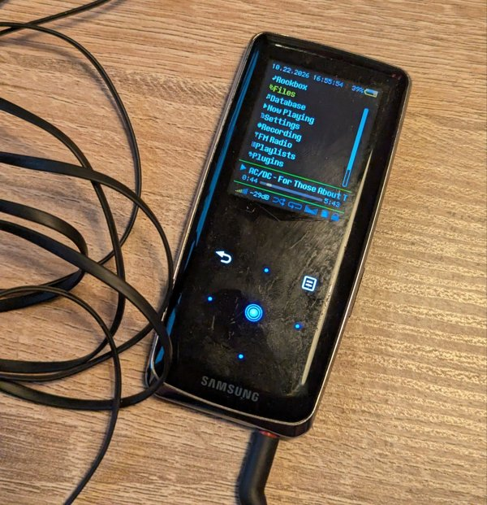

# Rockbox for the Samsung YP-S3

-555)

[Rockbox](https://www.rockbox.org), the open source firmware for music
players, running on the **Samsung YP-S3** (2009, 176x220 screen, touch
keys, FM radio). It installs next to Samsung's firmware: the player starts
Rockbox, and the original firmware is still there when you want it.

> **About this work.** It is based on Rockbox and on the partial YP-S3
> port that [Bertrik Sikken](https://github.com/bertrik) started in 2009.
> Upstream Rockbox removed that port in 2026 because it had never been
> able to read the player's internal flash. All the changes that made it
> work on my YP-S3 were implemented by Claude (Anthropic's AI model), with
> my help testing and debugging on the device.

**Tested on one 4 GB player only. Use it at your own risk.**

 

## What works

| Feature | Status |
|---|---|
| Music playback (all Rockbox codecs), stereo headphones | ✅ |
| Menus, file browser, database, themes, plugins and games | ✅ |
| Touch keys, backlight, key lights, LCD sleep, clock | ✅ |
| FM radio, presets, scanning | ✅ |
| Video (mpegplayer) | ✅ |
| USB mass storage | ✅ reads ~1.8 MB/s, writes ~0.6 MB/s |
| Charging, battery level, power off at low battery | ✅ battery curve not finely calibrated |
| Permanent install, original firmware kept | ✅ |
| Going back to the original firmware, DFU rescue | ✅ |
| FM recording | ❌ files are written but silent |
| LCD type 1 panels, other capacities | ❔ untested |

## Quick start

You need Linux, Python 3 with pyusb, and the player charged. Every step,
with the exact commands, is in
[YPS3-PORT.md, "Install, go back, rescue"](YPS3-PORT.md#install-go-back-rescue).

1. **Get the files:** `rockbox.zip`, `rockboot.ebn` and the tools from the
   latest [build](https://github.com/toyo97/rockbox-yps3/actions/workflows/yps3-build.yml)
   (artifact `yps3-rockbox`), or [build them yourself](YPS3-PORT.md#building).
2. **Back up the flash** over DFU mode. The backup is the only copy of
   your original firmware: keep it safe. Samsung's firmware is not part
   of this repository.
3. **Make the images** from the backup: `S3-original.ROM` and
   `S3-combined.ROM` (original firmware plus the Rockbox bootloader).
4. **Try the way back first:** copy `S3-original.ROM` to the player as
   `S3.ROM` and restart. The player's own bootloader installs it; nothing
   changes, but it proves the update path works on your unit.
5. **Install:** `yps3-install.sh` copies `S3-combined.ROM` and Rockbox to
   the player. Restart: the player updates itself and starts Rockbox.

**Original firmware:** keep the power slider pushed through the whole
start animation and let go when it stops on its last frame.
**Going back for good:** copy `S3-original.ROM` as `S3.ROM` again.

**DFU mode** (backup, rescue): with the USB cable plugged in, hold the
power slider, press a pin into the reset hole for 1-2 seconds, release
the pin, then shortly after the slider. The screen stays dark and the PC
sees USB device `0419:0145`.

The user manual (artifact `yps3-manual`) covers the keys and features.

## Acknowledgements

* The [Rockbox](https://www.rockbox.org) developers, for the firmware and
  the S5L8700 drivers shared with the iPod Nano 2G and the Meizu players.
* [Bertrik Sikken](https://github.com/bertrik), who started the YP-S3 port
  (LCD, keys, radio, power), and everyone in the
  [porting thread](https://forums.rockbox.org/index.php?topic=22418.0) and
  on the [wiki page](https://www.rockbox.org/wiki/SamsungYPS3).

This is not an official Rockbox release; please don't report problems with
it to the Rockbox project. No warranty (GPL version 2). Port notes,
hardware details and the development loop: [YPS3-PORT.md](YPS3-PORT.md).
